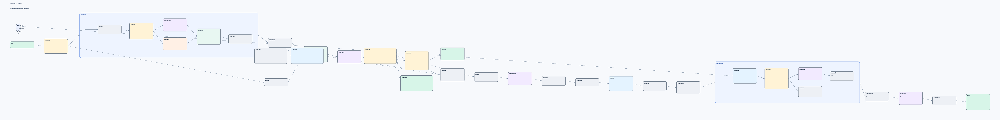

# 本地知识库问答：让资料真的派上用场

资料散在笔记、文档和截图里时，最难的往往不是“问 AI”，而是弄清楚它凭什么这么回答。

这是一个我在 Dify 里边用边打磨的本地知识库 Chatflow：先把问题和检索资料对上，再让回答只引用能核对的证据。临时上传的附件也能一起参考；它们只参与当前这轮问答，不会被流程送去入库。回答末尾会把用到的资料列出来，点开还能回看原文。

我把可导入的 DSL、迁移时要改的配置和整张流程图放在这里，方便自己留档，也给正在搭本地 RAG 的人一个能直接上手的起点。它不是开箱即用的托管服务：检索 bridge、向量库和模型仍需要你自己的 Dify 环境。

## 流程一览

## 文件

- [Dify Chatflow DSL](workflow/local_knowledge_chatflow.yml)：按当前发布图快照整理的可导入版本，公开文件不含有效密钥。
- [导入与配置说明](workflow/IMPORT.md)：模型、知识集、bridge 和附件行为的迁移说明。
- [完整流程图](workflow/workflow-overview.png)：40 个节点与 39 条连线；图片尺寸较大，打开原图可放大查看。

## 这个流程会做什么

- 结合对话和本轮附件理解问题，再检索本地知识库。
- 逐字校验可用证据；资料撑不起结论时，明确说还缺什么。
- 末尾只列本次确实用到的文档来源，并提供可核对的原文链接。
- 支持 Markdown、TXT、可提取文字的 PDF 和常见图片；附件只作为当前这一轮的参考，不会由这个流程送去入库。

扫描型 PDF 若没有可提取文字，可能读不到内容。Dify 平台仍可能按自身配置保存对话和上传文件；这部分请在自己的部署中检查。

## 导入前看一眼

模型插件、知识集 ID、bridge 地址都与 Dify 环境有关。导入后照着 [导入说明](workflow/IMPORT.md) 重新绑定；`BRIDGE_API_KEY` 只在 Dify 的环境变量界面填写，别提交到 Git。
