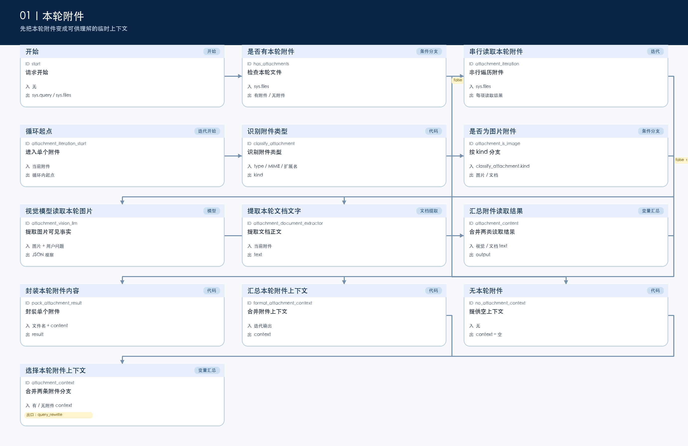
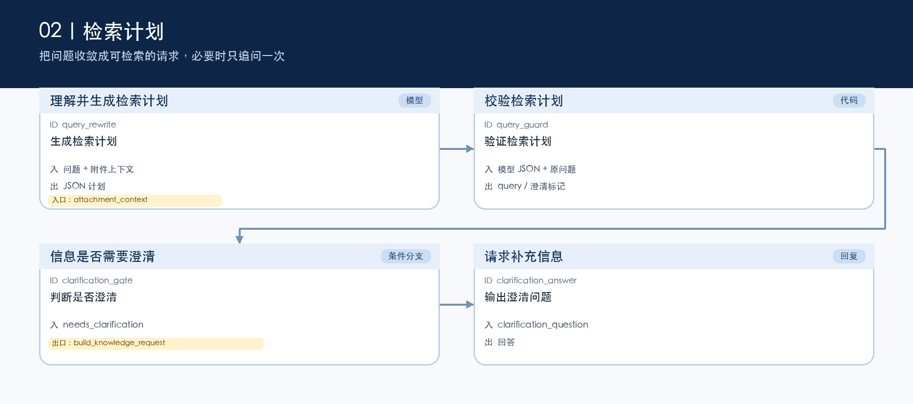
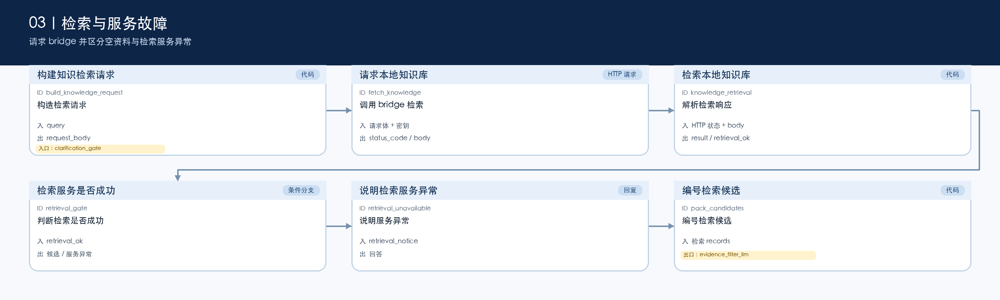
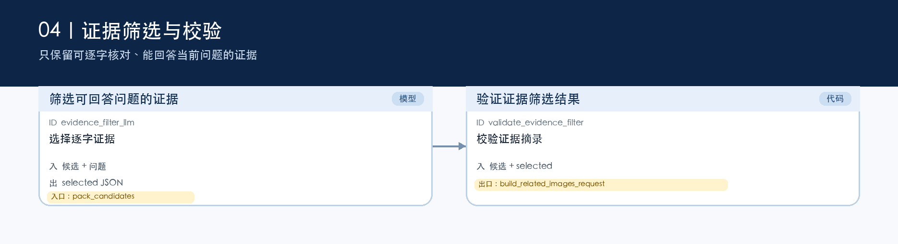
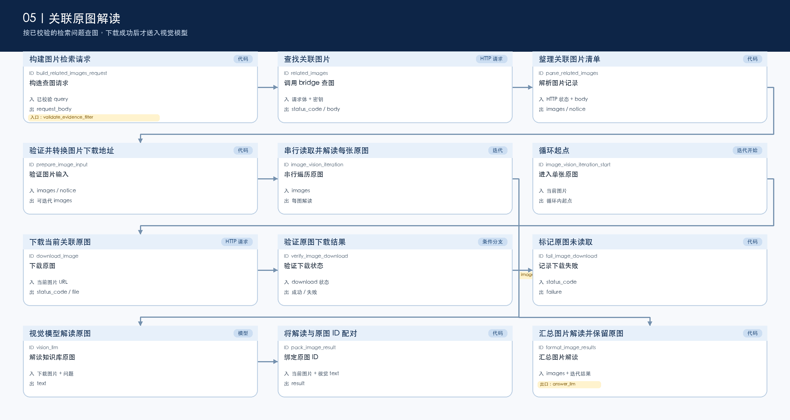
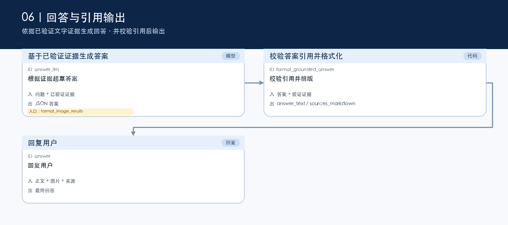

# 分段学习指南

这套流程的重点不是“检索后让模型自由回答”，而是把问题理解、检索、证据核验、图片解读和引用输出拆开。学习时先沿着主线看，再回到每个节点的配置；六张图用短标签方便读结构，完整变量、代码和提示词都收在[节点参考](NODE_REFERENCE.md)。

## 先看全局

主线是：本轮附件 → 检索计划 → bridge 检索 → 候选证据核验 → 可选的关联原图解读 → 带引用的回答。图由 DSL 重绘，展示的是实际连线和分支，不是 Dify 截图。

## 1. 附件只服务这一轮

有附件时，流程串行读取 `sys.files`：图片由视觉模型只记录可见事实，文档由提取器读取正文。两种结果被统一封装并合并；没有附件时走空上下文分支。这里的附件不会被送入 `/ingest`，也不会写入 Qdrant。循环内读取失败的策略是终止本轮，因此排查时先看附件是否可读。

## 2. 形成并校验检索计划

模型先输出结构化 JSON：检索问题、已确认事实、是否需要澄清和一句澄清问题。`query_guard` 再做代码级校验。只有主题或意图无法确定时，`clarification_gate` 才会直接回复追问；其它情况进入检索。因此“原因未知”本身不是阻止检索的条件。

## 3. 检索和故障分支

`build_knowledge_request` 发送给 bridge 的 `knowledge_id` 是固定字符串 `local_all`，它是 bridge 的知识空间参数，不是 Dify 的外部知识集选择器。请求的 `top_k` 是 5，`score_threshold` 是 0。HTTP 不是 200、JSON 格式不对或 records 不合法时，`knowledge_retrieval` 会把 `retrieval_ok` 设为 false，随后走“检索服务异常”回复；这与“检索正常但没有足够证据”不同。成功时才把最多 10 条返回记录编号为候选。

## 4. 先筛选，再验证逐字摘录

证据模型不能直接决定回答。它只能提交候选 ID 和连续逐字摘录；`validate_evidence_filter` 会检查摘录是否真的出现在对应候选中，再附加由检索记录提供的来源映射。校验不通过的条目会被丢弃，后面回答模型只能看到通过的证据。

## 5. 关联原图是可选补充

只有已校验的 query 会用于关联图请求，`top_k` 同样是 5。HTTP 返回已到达解析节点时，查图异常可转成 notice，继续文字回答；但 `related_images` 没有配置 HTTP 节点失败默认值，因此连接失败或超时仍可能直接中断运行，不能把所有查图失败都理解为可自动降级。每张原图都要先下载并通过状态检查；下载失败会标记失败，成功才交给视觉模型。最终图片观察被汇总给回答模型，但不能替代文字证据的引用校验。

## 6. 回答必须经过引用检查

回答模型按约定输出答案和使用的证据 ID。`format_grounded_answer` 会拒绝未验证的引用、空引用和不合格式的回答，并在成功时整理资料链接。最终 `answer` 节点按顺序拼接 `format_grounded_answer.answer_text`、`format_image_results.markdown`、`format_grounded_answer.sources_markdown`，也就是正文、图片补充和文档来源。

## 阅读顺序与运行前提

1. 先看上面的六张图，理解每段输入、输出和分支。
2. 在[节点参考](NODE_REFERENCE.md)中打开同 ID 的节点，阅读代码、完整提示词和模型配置。
3. 最后查看[导入说明](IMPORT.md)并导入 DSL。

当前公开文件中的模型配置都是 `provider: langgenius/deepseek/deepseek`、`name: deepseek-flash`。DSL 的 `dependencies` 为空，目标 Dify 环境需要自行安装对应插件并重新绑定模型；视觉节点还要确认模型支持图片。公开 DSL 未包含有效密钥，且尚未在另一套环境完成导入运行验证。
